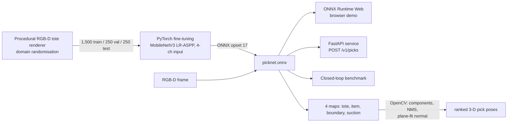

# PickVision

**RGB-D perception and suction-grasp planning for robotic picking from cluttered totes.**
A MobileNetV3 LR-ASPP network, fine-tuned in PyTorch, segments items and scores every pixel for
whether a vacuum cup would seal *and* lift the item free. OpenCV turns those maps into ranked 3-D
pick poses. The same ONNX model is served by a FastAPI microservice and runs in the browser with
ONNX Runtime Web.

**Live demo: https://nags-gk.github.io/pickvision/**

[](https://github.com/Nags-gk/pickvision/actions/workflows/ci.yml)

## Results

**Perception** on 250 held-out simulated totes (`results/seg_metrics.json`):

| Metric | RGB-D | RGB only (depth camera failed) |
|---|---:|---:|
| Top-1 pick precision: is the most confident pixel actually pickable? | **96.8%** | 94.4% |
| Suction-affordance average precision | 94.0% | 93.3% |
| Item mask IoU | 88.9% | 88.6% |

**Closed loop: clear the tote** (`results/clear_tote.json`). This covers 60 unseen totes and 460 items.
The policy sees only the camera. On a successful pick the item is removed and the scene is
re-rendered. Each tote allows two attempts per item, and failed points are not retried. Scoring stops
once nothing left can be lifted.

| Policy | Pick success | First-pick success | Items cleared |
|---|---:|---:|---:|
| *Ceiling: perfect ground-truth knowledge* | *100%* | *100%* | *71%* |
| Random point on an item | 16% | 33% | 31% |
| Highest-flat-surface heuristic (OpenCV, no learning) | 24% | 67% | 45% |
| Gradient boosting on hand-built features (scikit-learn) | 39% | 87% | 58% |
| PickNet, RGB only | 39% | 100% | 59% |
| **PickNet, RGB-D** | **42%** | **100%** | **59%** |
| **PickNet, RGB-D, confidence-gated (stops below 0.6)** | **70%** | **100%** | **56%** |

What the numbers say:
* **First picks:** the learned model takes the right first pick in every tote. The classic geometric heuristic manages two in three.
* **Clearing:** PickNet clears 84% of what is clearable (59% of 71%), against 63% for the heuristic.
* **Later picks are the hard part.** The easy items go first; what remains are pouches with only small sealable patches, and items partly buried under others. Gating on confidence trades 3 points of clearing for **1.7× the success rate (42% to 70%) with 43% fewer attempts**. In a real cell, each failed attempt costs cycle time, so the gated policy is the deployable one.
* **Depth helps but is not critical.** With the depth camera off, top-1 precision drops only from 96.8% to 94.4%, because depth was dropped from 30% of training images on purpose.

## How it works



**Simulator** (`pickvision/tote.py`)
* Stacks boxes, envelopes, bottles, lying cans, pouches, mesh bags and balls in z-order; each item rests on the highest surface beneath it.
* Randomises lighting direction, cast shadows, specular glare, colour and texture, sensor noise, blur, and depth dropout on shiny surfaces.
* A physics oracle labels a pixel pickable only if all of these hold:
  * the cup's whole footprint lies on one item, clear of its edges;
  * that patch's tilt is within the tolerance for that material;
  * the material can seal at all (mesh bags never do);
  * nothing rests on top of the item.

**Model** (`pickvision/model.py`, `train.py`)
* COCO-pretrained LR-ASPP MobileNetV3-Large (3.2M parameters). The first conv is widened to accept a depth/height channel, initialised from the RGB filters.
* The heads output tote, item and boundary classes plus a suction score.
* Training uses 192 px random crops, rotations and flips, photometric jitter, and depth-channel dropout on 30% of samples.
* The loss is class-weighted cross-entropy plus BCE.
* 12 epochs on CPU take about 31 minutes.

**Grasp planning** (`pickvision/grasp.py`)
* Items are connected components of the item-interior map.
* Pick candidates come from Gaussian-smoothed suction peaks with non-maximum suppression.
* The approach direction is a least-squares plane fit to the depth patch under the cup, back-projected through the camera intrinsics.

**Baselines** (`pickvision/baselines.py`, `grasp.py`)
* An OpenCV "highest flat surface, far from edges" heuristic using depth gradients and a distance transform.
* A scikit-learn HistGradientBoosting per-pixel classifier on 10 hand-built geometric and colour features.

**Serving** (`pickvision/service.py`)
* A FastAPI service with no PyTorch at runtime, only ONNX Runtime.
* `POST /v1/picks` takes an RGB PNG and an optional 16-bit depth PNG in millimetres and returns ranked picks with 3-D points and normals.
* `/healthz` and `/metrics` report request count, errors, and p50/p95 latency.

## Run it

```bash
pip install torch torchvision --index-url https://download.pytorch.org/whl/cpu && pip install -r requirements.txt
python -m pytest -q                                   # 10 tests, including an end-to-end API test on the ONNX model
python -m pickvision.dataset --out data               # render 2,000 totes (about 5 minutes on 2 cores)
python -m pickvision.train --data data --out artifacts
python -m pickvision.export && python -m pickvision.report
python -m pickvision.evaluate --totes 60              # closed-loop benchmark (about 15 minutes)
uvicorn pickvision.service:app --port 8080
```

## Limitations

* Everything is simulated: top-down camera, procedural items, an analytic suction model. Real totes add transparent and deformable items, reflections and calibration error, and need real data or sim-to-real adaptation.
* Instance separation relies on a thin boundary class, which the network finds hard (boundary IoU 26%). Touching items of similar colour can merge. The suction map does not depend on it.
* Suction only, with no two-finger grasps, and no arm motion planning or collision checking.
* The browser demo's "try your own photo" runs in RGB-only mode and has no ground truth to check against.

## License

MIT
